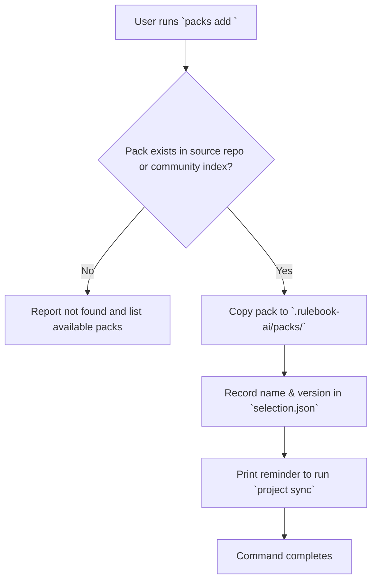
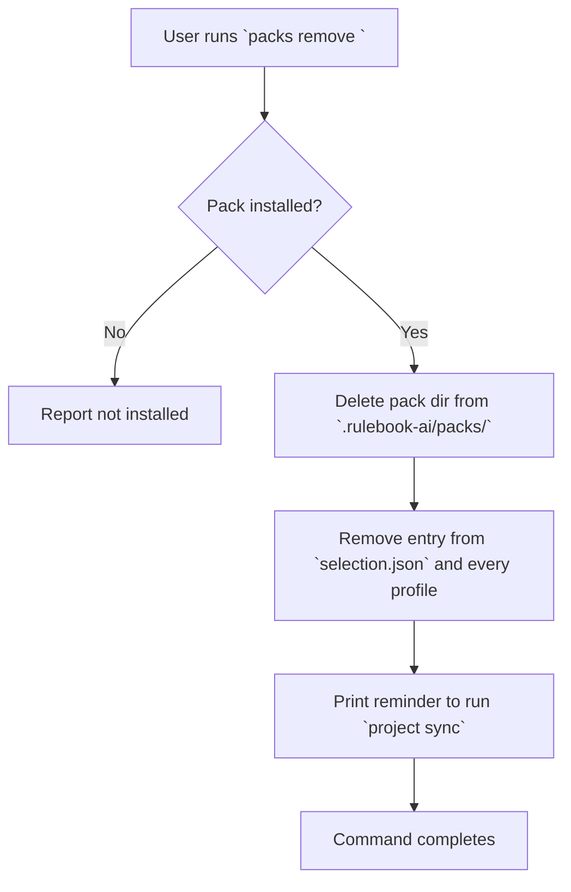
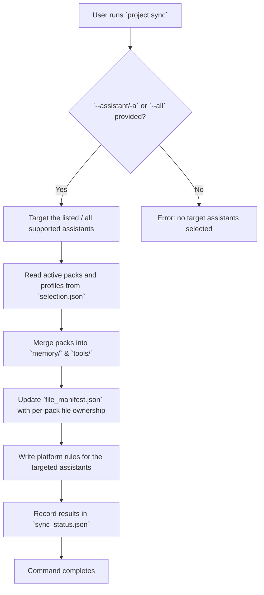
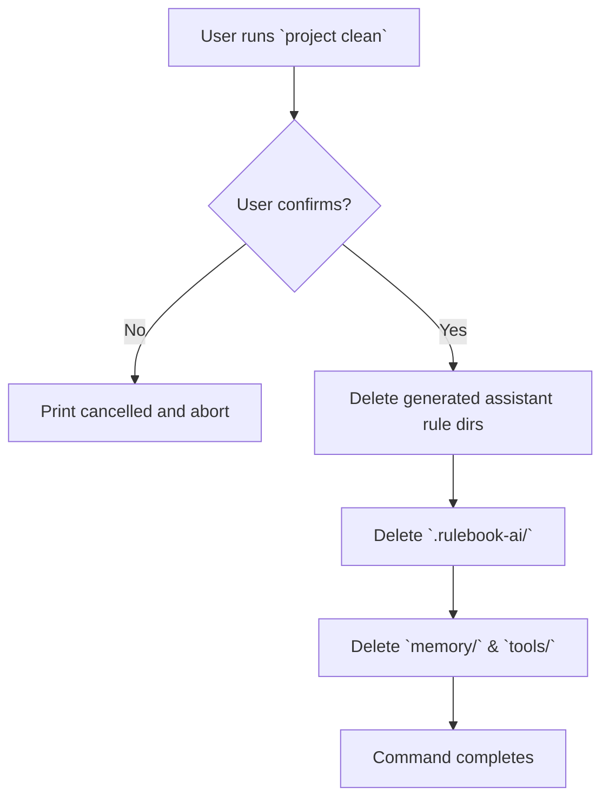
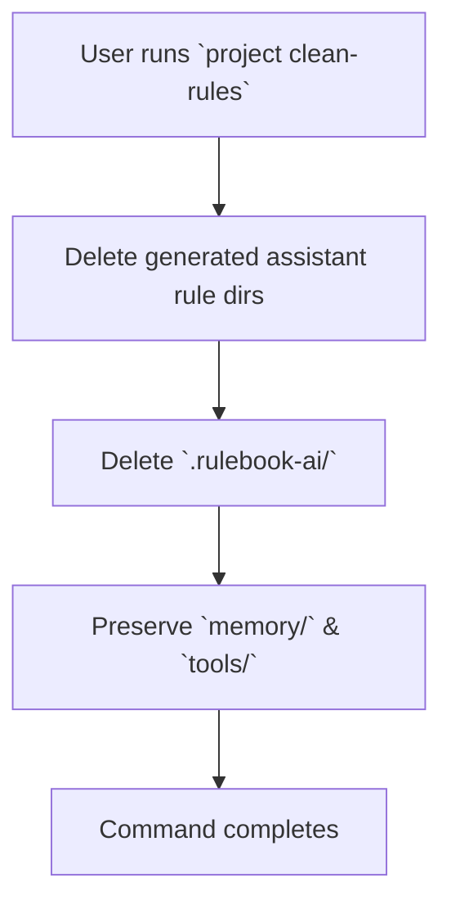
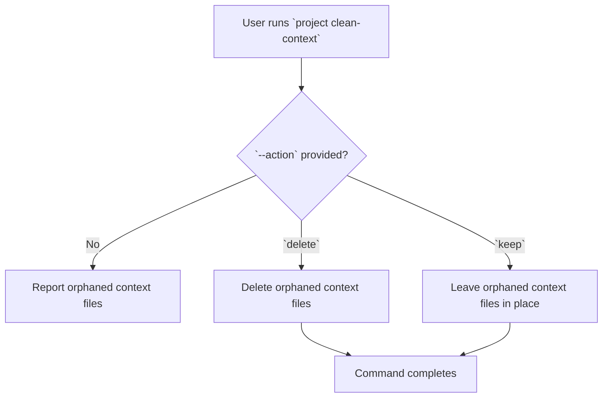

# Command Flow Diagrams

This document visualizes the high-level flow of major commands introduced in the composable pack system. Diagrams focus on
spec-level behavior rather than implementation details.

## `rulebook-ai packs add <name>`

*`packs add` only edits the pack library. It does not touch `memory/`, `tools/`, or generated rules — the user must run `project sync` explicitly.*

## `rulebook-ai packs remove <name>`

*`packs remove` only edits the pack library. Files previously copied into `memory/` and `tools/` are purged by the next `project sync`, using the pack's entries in `file_manifest.json`.*

## `rulebook-ai project sync`

## `rulebook-ai project clean`

## `rulebook-ai project clean-rules`

*Unlike `project clean`, `project clean-rules` runs without a confirmation prompt; it never touches user-owned `memory/` and `tools/`.*

## `rulebook-ai project clean-context`

*`--force` skips the prompt when removing orphaned context files.*
